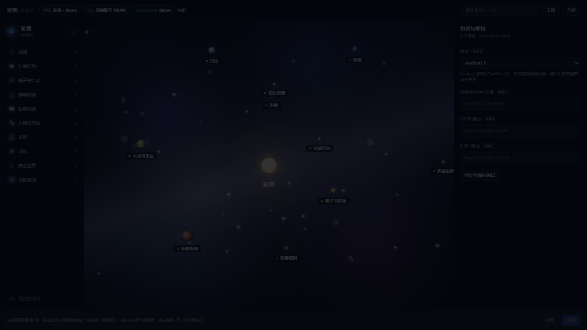

# 星图控制台 · Star Console

一个注入式的可视化控制台：把一组配置项画成**太阳系星图**——中心是一颗恒星，功能节点是环绕它的行星，左侧是可收起的导航，右侧是参数抽屉。

界面是纯原生 JavaScript + CSS，无构建、无框架、无外部依赖；宿主侧是一个 Cordis 插件（Host 半边），负责把样式和脚本注入页面、并提供读写配置的本地 API。

> 模型说明：本项目的界面与代码由 **DeepSeek 模型**（deepseek-flash / deepseek-v4-pro）协助生成，运行在 DeepSeek Harness 生态中。



## 演示

仓库带一个只读演示：直接打开 `demo/index.html` 即可。示例数据直接由控制台 schema 生成（9 个分支、31 个叶子节点、字段类型与视图全部保留），所有值清空、不含真实配置；Host 侧的读写接口在演示里被替换成示例响应，界面、星空、行星、星域和记忆星图都能点。

## 界面

- **总览**：中心恒星 + 九大行星（水星到冥王星）+ 月球，按各自轨道公转；每颗行星有独立的表面贴图（木星条纹与大红斑、土星环、地球大陆与极冠、火星暗斑、陨坑等），明暗按太阳方向逐帧计算。
- **星域**：点行星进入星域视图——中央是一团程序生成的星云贴图，设置项化作一圈会缓慢公转的星点，点星点在右侧抽屉里编辑。
- **背景**：分层星空、蓝紫星云、斜穿画面的银河（多层光带 + 核尘带）、带陨石坑的小行星、星际碎石、偶尔划过的流星、缓慢转动的碎石行星带。
- **导航**：左侧可收起，条目可拖拽排序，顺序记在浏览器本地。
- **记忆星图**：把日记档案铺成一片自转的银河，点星星看正文，可编辑、可删除（删除前自动备份）。

## 目录

```
star-console-open/
├─ lib/
│  ├─ index.js     Host 半边：注入、本地 API、读写配置、服务动作
│  ├─ schema.js    界面 schema 单一事实源（节点树、字段、默认值）
│  └─ store.js     文件层：读配置 / 备份 / 原子写
├─ runtime/
│  ├─ panel.js     Browser 半边：星图界面（单文件，约 3700 行）
│  └─ panel.css    样式
├─ demo/
│  ├─ index.html       只读演示页（示例数据）
│  └─ sample-data.js   由 schema 生成的示例树 / 空值 / 虚构日记
├─ docs/
│  └─ preview.png      界面预览
├─ package.json
├─ LICENSE
└─ README.md
```

## 设计约束

- 注入行必须是**同步**注册的，失败只告警、不阻断宿主启动。
- 所有写配置都走「备份 → 临时文件 → rename」，避免写一半把配置弄坏。
- 界面不硬编码字段：节点树与字段全部由 Host 的 schema 下发，前端只负责渲染。


## 项目大纲（启动依赖）

启动链路：

1. **Host 半边**：`lib/index.js` 以 Cordis 插件注册（`name = 'star-console'`）。在 `apply` 里**同步**向 `webserver/index-inject` 推送两行注入（`panel.css` + `panel.js`），再把 `/star-console/api/*` 路由挂到本地 webserver。
2. **页面半边**：注入脚本执行后挂上悬浮入口；打开控制台时调用 `GET /star-console/api/bootstrap`，一次性拿到节点树、当前值、角色与路径。
3. **数据层**：`lib/schema.js` 是节点树 / 字段 / 默认值的唯一事实源；`lib/store.js` 负责读写 `bridgeDir` 下的 `config.json` / `roles/` / `current-role.json`，写前备份、临时文件 + rename，避免写坏。
4. **可选依赖**：`bridgeDir` 指向的上游桥接配置（默认 `~/.star-console/bridge`，可由插件 config 覆盖）；记忆星图读本地 diary 目录的只读接口；服务类按钮（启动 / 重启）走本机进程管理，不用也不影响界面。

| 文件 | 角色 | 依赖 |
| --- | --- | --- |
| `lib/index.js` | 注入 + 本地 API + 服务动作 | `schema.js`、`store.js`、Node 内置 `fs`/`os`/`path`/`child_process` |
| `lib/schema.js` | 节点树 / 字段 / 默认值 | 无 |
| `lib/store.js` | 配置读写、备份、原子写 | `fs`、`path`、`os` |
| `runtime/panel.js` | 整个界面与交互 | 浏览器原生 API（Canvas / SVG / fetch），无第三方库 |
| `runtime/panel.css` | 样式与动画 | 无 |

运行时不需要构建工具、打包器或第三方 npm 依赖。
## 隐私

- 仓库不含任何用户数据、日记、账号、令牌或本机绝对路径。
- 默认路径是用户目录下的占位目录，实际部署时由插件配置覆盖。

## 许可

MIT，见 [LICENSE](./LICENSE)。